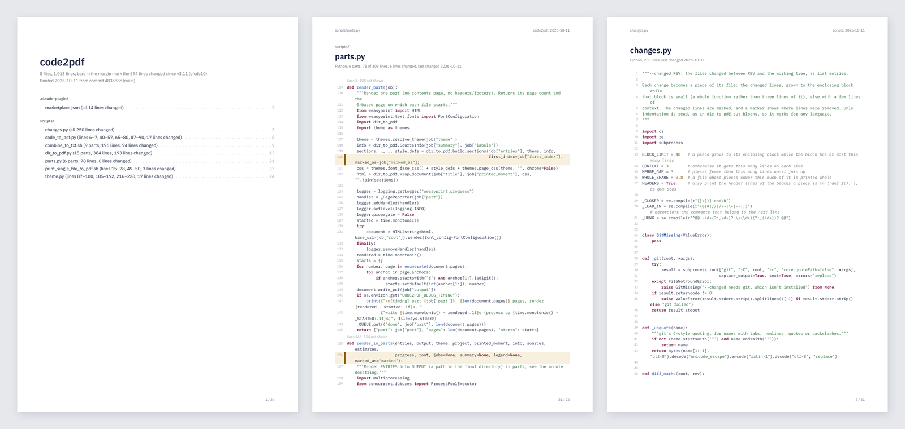

# code2pdf for VS Code

Print source code as a PDF made for reading on paper or a tablet: a contents page, syntax
highlighting, each file's own line numbers, its path on every page, and a bookmark per file.
Print a folder, a few files, the lines you selected, or what changed in git, with the changed
lines marked in the margin.

The extension runs the [code2pdf](https://github.com/readbysearch/code2pdf) command-line tool,
on macOS and Linux. Your code stays on your machine.

## Install code2pdf first

The extension needs code2pdf 3.12 or later. When you install the extension, its **Get Started**
page opens with the install as step 1, and **code2pdf: Install the Command-Line Tool** in the
Command Palette does the same. If you print before installing it, the extension offers to install
it then. Either way the install runs in a terminal, where you can see the command, and VS Code
tells you when it's ready (with **Print Now**, if you were printing):

| System | Command |
| --- | --- |
| macOS, or Linux with Homebrew | `brew install readbysearch/tap/code2pdf` |
| Ubuntu 24.04+, Debian 13+ | `wget https://github.com/readbysearch/code2pdf/releases/latest/download/code2pdf_all.deb && sudo apt install ./code2pdf_all.deb` |
| Other Linux, no sudo | `wget -qO- https://raw.githubusercontent.com/readbysearch/code2pdf/main/install.sh \| bash -s -- --user` |

`curl -LO` and `curl -sSL` work in place of `wget` and `wget -qO-`. The extension's install
button uses whichever of the two the machine has (a fresh Ubuntu desktop has only `wget`).

On Windows, use [WSL](https://code.visualstudio.com/docs/remote/wsl): open your folder in WSL,
install code2pdf there, and print from that window. Over Remote SSH, code2pdf runs on the remote
machine.

## Printing

Right-click in the Explorer, an editor, an editor tab or the Source Control menu, or run the
commands from the Command Palette (they start with "code2pdf").

- **A folder**: right-click it and choose **Print to PDF**. code2pdf picks the source files: it
  leaves out hidden folders, build output, vendored dependencies, binary files and data files such
  as JSON. The `include` and `exclude` settings change that.
- **Chosen files**: right-click a folder and choose **Choose Files and Print to PDF…**. Every file
  code2pdf would print is listed and checked; uncheck the ones to leave out.
- **Several files or folders**: select them in the Explorer, then **Print to PDF**. They print as
  one PDF, sorted by path, each folder with code2pdf's usual selection.
- **A file**: right-click it, its tab or its editor, and choose **Print File to PDF**.
- **Some lines**: select them and choose **Print Selection to PDF**. They print with their real
  line numbers, and several selections print together.
- **Changes**: choose **Print Changes to PDF…** from the Source Control menu or the Command
  Palette, then what to print:
  - your uncommitted changes;
  - the last commit;
  - this branch since it left `main`;
  - a recent commit and everything after it;
  - or the changes since a commit, tag or branch you name.

  Each change prints with the code around it, such as the whole function it's in, and the
  changed lines are marked with a bar in the margin. Files that git doesn't track yet are left
  out, with a note.

A progress notification shows the page count as code2pdf works. Cancel it to stop. When it's
done, the PDF opens in your PDF viewer, and any warnings from code2pdf are shown. Everything
code2pdf printed is in the **code2pdf** output panel.

## Settings

| Setting | Default | What it does |
| --- | --- | --- |
| `code2pdf.outputFolder` | empty | A folder to save PDFs in without asking. Empty: you choose where each PDF goes. |
| `code2pdf.openWith` | `viewer` | Open the PDF in your PDF `viewer`, in a VS Code tab (`editor`, needs a PDF viewer extension), or `none`. |
| `code2pdf.theme` | `paper` | `paper`, `mono` (black and white, for printers), or any Pygments style, such as `github-dark`. |
| `code2pdf.include` | `[]` | Globs to add when printing a folder: `*.json`, `.github`, `vendor/mylib`. |
| `code2pdf.exclude` | `[]` | Globs to leave out when printing a folder or changes: `tests`, `*_test.go`, `docs/**/*.md`. |
| `code2pdf.executable` | empty | The path to `code2pdf`, if it isn't on your `PATH` or in the usual install folders. |

Without `/`, a glob matches names at any depth; with `/`, it matches the path from the folder.
Put `include` and `exclude` in a workspace's `.vscode/settings.json` to set them per project.

### Coming from version 1

Version 2 is a new extension under the same name, and VS Code updates to it on its own. What's
different:

- **It needs the code2pdf tool** instead of Vim, Ghostscript and jq. The first print offers to
  install it.
- **You choose where each PDF goes.** Version 1 saved `merged.pdf` (or `<file>.pdf`) into the
  project folder. To save into the project again without being asked, set
  `code2pdf.outputFolder` to `.`. A folder's PDF is then named after the folder, such as
  `shop.pdf`.
- **More files are printed.** Version 1 printed only `.py` and `.sh` files, plus `README.md` and
  `launch.json`. Version 2 prints all common source code, Markdown, YAML and TOML, and skips
  build output, virtual environments and hidden folders. Use `code2pdf.exclude` to leave files
  out.
- **"Print All Src File to A Single PDF" is now "Print All Source Files to PDF".** Keybindings to
  the old commands still work.
- **The PDF opens when it's done.** Set `code2pdf.openWith` to `none` to turn that off.
- **Your old settings still work** if you set them (`blacklisted_folders`,
  `whitelisted_file_extensions` and so on). One difference: `blacklisted_folders` now adds to the
  folders code2pdf skips (`node_modules`, `dist`, `out` and others) instead of replacing them.
- **It no longer touches files it shouldn't.** Version 1 deleted the PDFs in `/tmp`, saved each
  file it printed again (adding a final newline where one was missing), and left an empty file
  behind for a name with a space in it.

## Also from code2pdf

- On the command line, `code2pdf --help` lists everything, including `--summary` for a line
  under the title, and `code2txt` for one Markdown file to give an LLM.
- The [Claude Code skill](https://github.com/readbysearch/code2pdf#using-code2pdf-from-a-coding-agent) lets Claude
  print code for you: "print my last commit for review, with the changes marked".

## Problems and ideas

[Open an issue](https://github.com/readbysearch/code2pdf-vscode/issues). If a print fails, the
**code2pdf** output panel has the command that ran and everything it printed.

## License

AGPL-3.0-only, like code2pdf.
