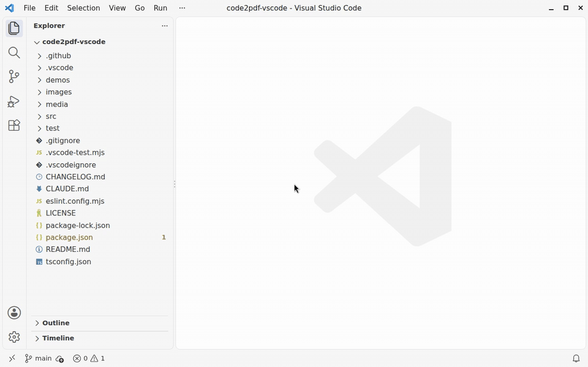
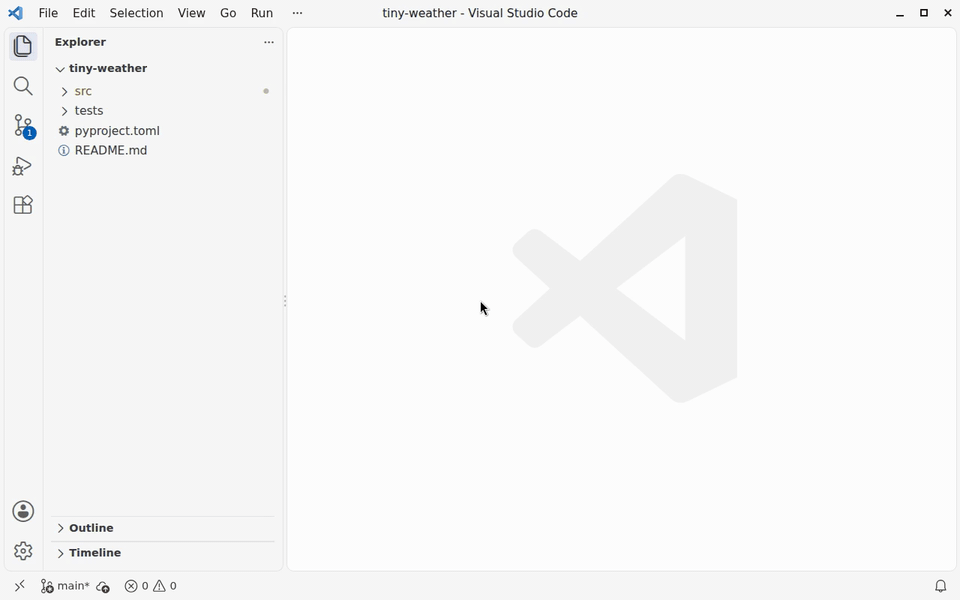
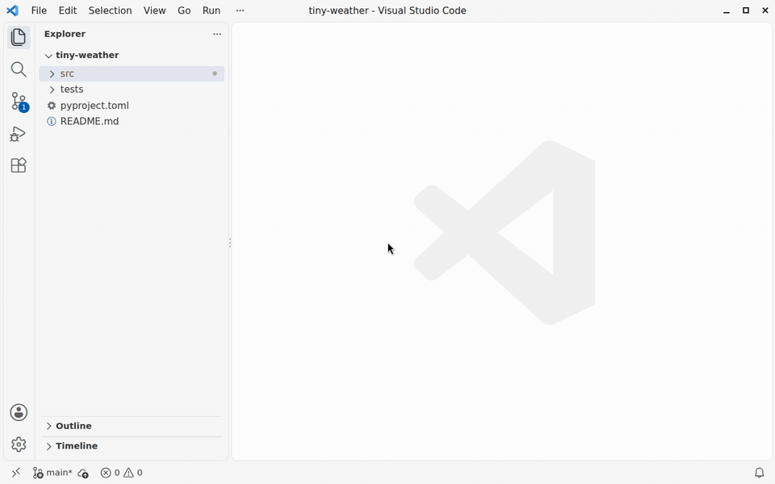
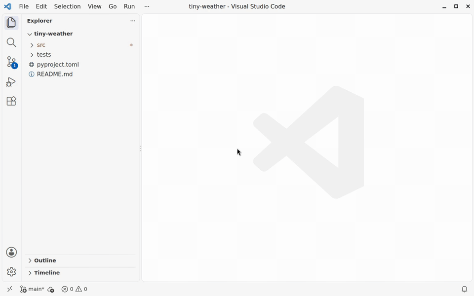
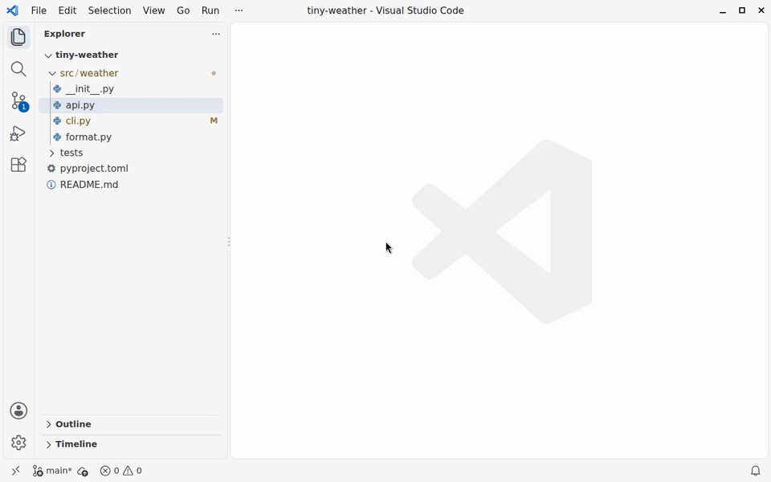

# code2pdf for VS Code

Print source code as a PDF made for reading on paper or a tablet: a contents page, syntax
highlighting, each file's own line numbers, its path on every page, and a bookmark per file.
Print a folder, a few files, the lines you selected, or what changed in git, with the changed
lines marked in the margin.



The extension runs the [code2pdf](https://github.com/readbysearch/code2pdf) command-line tool,
on macOS and Linux. Your code stays on your machine. Anonymous [usage data](#usage-data) is sent
only when VS Code's telemetry is on, and `code2pdf.telemetry` turns it off for this extension
alone.

## Install code2pdf first

The extension prints with the code2pdf command-line tool, version 3.12 or later, on macOS and
Linux. There are two ways to install it.

**From VS Code.** Click Install on the extension's Get Started page, which opens when you install
the extension, or run **code2pdf: Install the Command-Line Tool** from the Command Palette. If you
print before installing it, the extension offers the same button. It picks the installer for your
machine and runs it in a terminal, where you see what it does and answer its questions: Homebrew
asks you to confirm, apt asks for your password. When code2pdf is ready, VS Code says so, with
**Print Now** if you were printing.

**By hand,** in a terminal. On macOS, Homebrew needs no sudo. On Linux, install code2pdf for
everyone on the machine, which needs sudo, or just for yourself, which doesn't (also the way to go
where you can't use sudo, such as a shared server).

- macOS, or Linux with Homebrew:

  ```bash
  brew install readbysearch/tap/code2pdf
  ```

- Linux, for all users (sudo):
  - Ubuntu 24.04 or later, or Debian 13 or later: download the .deb, then install it with apt.

    ```bash
    wget https://github.com/readbysearch/code2pdf/releases/latest/download/code2pdf_all.deb
    sudo apt install ./code2pdf_all.deb
    ```

  - Other Linux: install into `/usr/local`. The script asks for your password.

    ```bash
    wget -qO- https://raw.githubusercontent.com/readbysearch/code2pdf/main/install.sh | bash -s -- --system
    ```

- Linux, just for you (no sudo), on any Linux: install into `~/.local`.

  ```bash
  wget -qO- https://raw.githubusercontent.com/readbysearch/code2pdf/main/install.sh | bash -s -- --user
  ```

If you have curl rather than wget, use `curl -LO URL` to download a file and `curl -sSL URL` to
print it. A fresh Ubuntu desktop has only wget.

On Windows, use [WSL](https://code.visualstudio.com/docs/remote/wsl): open your folder in WSL,
install code2pdf there, and print from that window. Over Remote SSH, code2pdf runs on the remote
machine.

## Printing

Right-click in the Explorer, an editor, an editor tab or the Source Control menu, or run the
commands from the Command Palette (they start with "code2pdf"). In the clips below, the PDF opens
in a VS Code tab (`code2pdf.openWith` set to `editor`, with a PDF viewer extension); by default it
opens in your PDF viewer.

### A folder

Right-click it and choose **Print to PDF**. code2pdf picks the source files: it leaves out hidden
folders, build output, vendored dependencies, binary files and data files such as JSON. The
`include` and `exclude` settings change that.



### Chosen files

Right-click a folder and choose **Choose Files and Print to PDF…**. Every file code2pdf would
print is listed and checked; uncheck the ones to leave out.



### Some lines

Select them and choose **Print Selection to PDF**. They print with their real line numbers, and
several selections print together.



### What changed

Choose **Print Changes to PDF…** from the Source Control menu or the Command Palette, then what to
print: your uncommitted changes, the last commit, this branch since it left `main`, a recent commit
and everything after it, or the changes since a commit, tag or branch you name. Each change prints
with the code around it, such as the whole function it's in, and the changed lines are marked with
a bar in the margin. Files that git doesn't track yet are left out, with a note.



### Several files, or one file

Select several files and folders in the Explorer, then **Print to PDF**: they print as one PDF,
sorted by path, each folder with code2pdf's usual selection. For one file, right-click it, its tab
or its editor and choose **Print File to PDF**.

A progress notification shows the page count as code2pdf works. Cancel it to stop. When it's
done, the PDF opens, and any warnings from code2pdf are shown. Everything code2pdf printed is in
the **code2pdf** output panel.

### The pages

A contents page with page numbers, then each file with its path, its own line numbers and the date
it last changed in git; a print of changes marks the changed lines with a bar in the margin.


## Settings

| Setting | Default | What it does |
| --- | --- | --- |
| `code2pdf.outputFolder` | empty | A folder to save PDFs in without asking. Empty: you choose where each PDF goes. |
| `code2pdf.openWith` | `viewer` | Open the PDF in your PDF `viewer`, in a VS Code tab (`editor`, needs a PDF viewer extension), or `none`. |
| `code2pdf.theme` | `paper` | `paper`, `mono` (black and white, for printers), or any Pygments style, such as `github-dark`. |
| `code2pdf.include` | `[]` | Globs to add when printing a folder: `*.json`, `.github`, `vendor/mylib`. |
| `code2pdf.exclude` | `[]` | Globs to leave out when printing a folder or changes: `tests`, `*_test.go`, `docs/**/*.md`. |
| `code2pdf.executable` | empty | The path to `code2pdf`, if it isn't on your `PATH` or in the usual install folders. |
| `code2pdf.telemetry` | `true` | Send anonymous [usage data](#usage-data), when VS Code's telemetry is on as well. `false` turns it off for this extension alone. |

Without `/`, a glob matches names at any depth; with `/`, it matches the path from the folder.
Put `include` and `exclude` in a workspace's `.vscode/settings.json` to set them per project.

### Coming from version 1

Version 2 is a new extension under the same name, and VS Code updates to it on its own. What's
different:

- **It needs the code2pdf tool** instead of Vim, Ghostscript and jq. The first print offers to
  install it.
- **You choose where each PDF goes.** Version 1 saved `merged.pdf` (or `<file>.pdf`) into the
  project folder. To save into the project again without being asked, set
  `code2pdf.outputFolder` to `.`. A folder's PDF is then named after the folder, such as
  `shop.pdf`.
- **More files are printed.** Version 1 printed only `.py` and `.sh` files, plus `README.md` and
  `launch.json`. Version 2 prints all common source code, Markdown, YAML and TOML, and skips
  build output, virtual environments and hidden folders. Use `code2pdf.exclude` to leave files
  out.
- **"Print All Src File to A Single PDF" is now "Print All Source Files to PDF".** Keybindings to
  the old commands still work.
- **The PDF opens when it's done.** Set `code2pdf.openWith` to `none` to turn that off.
- **Your old settings still work** if you set them (`blacklisted_folders`,
  `whitelisted_file_extensions` and so on). One difference: `blacklisted_folders` now adds to the
  folders code2pdf skips (`node_modules`, `dist`, `out` and others) instead of replacing them.
- **It no longer touches files it shouldn't.** Version 1 deleted the PDFs in `/tmp`, saved each
  file it printed again (adding a final newline where one was missing), and left an empty file
  behind for a name with a space in it.

## Usage data

When VS Code's telemetry is on, the extension sends a few anonymous events, to show where people
get stuck getting code2pdf and printing. It sends nothing when `telemetry.telemetryLevel` is
`off`, `crash` or `error`, which turns usage data off for VS Code and every extension, or when
`code2pdf.telemetry` is `false`, which turns it off for this extension alone. A project's
settings can't turn it back on.

- **When it starts:** whether code2pdf was found, its version and how it was installed, whether
  Homebrew is installed, and on Linux the distribution and its version.
- **When it offers to install or update code2pdf:** why, the buttons it showed, and the one you
  chose.
- **When an install it started is done**, or after 30 minutes without one: how long it took.
- **When a print ends:** what was printed (a file, some lines, a folder, chosen files or
  changes), whether it printed, failed or was cancelled, the pages, how long it took, and
  whether the PDF's place came from the save dialog or the `code2pdf.outputFolder` setting.

Each event also carries the versions of the extension and VS Code, the editor's name, the
operating system and processor type, the kind of remote session, and a random ID for this
session, which isn't saved. Never your name, file names, paths or code, and no ID that lasts.
Events go to Azure Application Insights, in the EU. The extension tells Azure not to work out a
location from your IP address, and Azure doesn't store the address. They're deleted after 90
days. `telemetry.json` in the extension lists every field, and the [privacy policy](PRIVACY.md)
has the details.

## Also from code2pdf

- On the command line, `code2pdf --help` lists everything, including `--summary` for a line
  under the title, and `code2txt` for one Markdown file to give an LLM.
- The [Claude Code skill](https://github.com/readbysearch/code2pdf#using-code2pdf-from-a-coding-agent) lets Claude
  print code for you: "print my last commit for review, with the changes marked".

## Problems and ideas

[Open an issue](https://github.com/readbysearch/code2pdf-vscode/issues). If a print fails, the
**code2pdf** output panel has the command that ran and everything it printed.

## License

The extension is under the [MIT License](LICENSE). The code2pdf command-line tool it runs is
separate, under the AGPL-3.0 (see [its license](https://github.com/readbysearch/code2pdf#license)).

The code2pdf name and logo are not covered by either licence: a fork needs its own name and icon.
